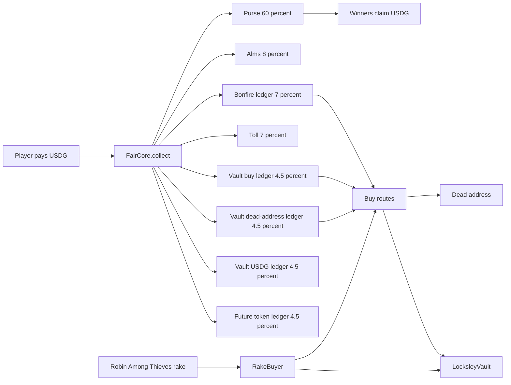
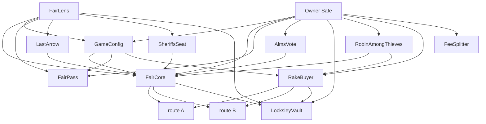

# Game of Splits

Game of Splits is a USDG fair on Robinhood Chain. A wallet locks $WIF in a Fair Pass and then pays USDG at two booths, Last Arrow and the Sheriff's Seat. The same pass is required at Robin Among Thieves. Each payment is split once in FairCore. Most of it stays in that round's purse for the winners. The rest is booked to charity, to a toll, and to USDG ledgers that buy $WIF.

The play token, the pass amount, the buy token and the shot split live in GameConfig. The site reads them from `FairLens.configNow()`. Launch values are below. A later change is a queued update.

Game of Splits is not affiliated with Robinhood Markets.

## How $WIF is used onchain

At launch the play token and the buy token are both $WIF. On Robinhood Chain testnet (chain id 46630) those two roles are the test token at the `wif` address in [`contracts/deployments/46630.json`](contracts/deployments/46630.json). Its onchain name is Test World is Flat and its symbol is tWIF. tWIF has 18 decimals. tUSDG stands in for USDG and has 6 decimals.

$WIF moves in three ways.

1. Fair Pass. `FairPass.lock` pulls 5,000 $WIF (5,000 tWIF on this testnet) and holds it for at least 24 hours. `unlock` returns the same token and the same amount. The owner cannot take it and cannot extend the hold. Last Arrow, the Sheriff's Seat, outlaw registration and outlaw entry all read this pass. The pass that is checked is the controller's, even when an operator sends the entry.
2. Outlaw licence. Robin Among Thieves locks 1,000 $WIF when an outlaw is registered. Retire returns it after 24 hours. Retire, withdraw and claim do not require a live pass, so a lapsed pass cannot trap the licence, the bond or the budget.
3. Buy token. The keeper swaps booked USDG for the current buy token, which is $WIF at launch. `burnBuyToken` sends that output to the dead address `0x000000000000000000000000000000000000dEaD`. `buyForVault` sends it to LocksleyVault and leaves it there. RakeBuyer does the same buy with Robin Among Thieves rake, then forwards the bought token and a matching USDG amount to LocksleyVault.

Nothing in this repository spends a player's locked $WIF as a fee. Unlock and retire pay the recorded amount back.

## Where a shot goes

`FairCore.collect` is the only purse credit. Launch `GameConfig.split` is 6,000 / 2,000 / 1,750 / 1,750 / 2,500 / 2,500 / 2,500 in basis points. On a shot that is:

| Share of the shot | Basis points | Ledger |
| --- | --- | --- |
| Purse, paid later to that round's winners | 60% | `pot` |
| Alms, a charity players vote on | 8% | `almsByFair` |
| Bonfire, USDG waiting to buy $WIF for the dead address | 7% | `bonfirePending` |
| Toll | 7% | `tollPending` |
| Vault buy, USDG waiting to buy $WIF for LocksleyVault | 4.5% | `vaultBuyPending` |
| Vault USDG held for a future pool | 4.5% | `vaultLiqUsdg` |
| Vault USDG waiting to buy $WIF for the dead address | 4.5% | `vaultBurnPending` |
| Vault USDG held for a future token | 4.5% | `vaultFairsBurnUsdg` |

The four vault rows are 45% of the Greenwood (the 40% that is not the purse), split in four equal parts. Rounding dust on the vault split stays in `vaultFairsBurnUsdg`. The parts add up to the shot.

Last Arrow then pays its purse 50% to the last shot, 35% across the 10 shots before it, and 15% to the wallet that fired the most shots. The Sheriff's Seat pays its day's purse 75 / 20 / 5 to the three wallets that held the seat the longest. Days on mainnet end at 00:00 UTC. This testnet deployment uses a 7,200 second day, and `day0` is 30 Oct 2026 00:00 UTC.

Alms release sends USDG to the Alms Safe. The donation on donate.gg is made by hand. AlmsVote holds no funds. If a Fair gets no votes, the Alms carry to the next Fair.

## Flywheel



The keeper calls `burnBuyToken` for the Bonfire ledger and for `vaultBurnPending`. Both outputs go to the dead address. The keeper calls `buyForVault` for `vaultBuyPending`. That output goes to LocksleyVault. Each call is capped at 250 USDG, waits 50 minutes per ledger, and stops at 3,000 USDG per ledger per UTC day. `minOut` has to clear a price floor. The floor is 95% of an anchor that falls at 1% per hour, at most 30%, and does not fall below 70% of the high-water anchor. The anchor can rise at most 2% per 4 hour window.

Buybacks (the Bonfire and the Vault) swap USDG for the buy token. The route pays FairCore, FairCore measures its own balance, and it forwards that amount to the Locksley Vault or to the dead address. Fee-on-transfer buy tokens are unsupported. A fee taken on the way in can drop the measured amount below `minOut`, and the swap reverts. A fee taken on the way out can revert the transfer to the vault or the dead address, or leave that recipient with less than what the `Burned` / `BoughtForVault` event and the return value report. The residual risk on swap payees is in [SECURITY.md](SECURITY.md#swap-payee-residual).

Robin Among Thieves stakes 5 USDG a player. A settled match pays out of a 10 USDG pot after a 5% rake. 40% of the rake stays in the Sharing Pot. 60% is `rakePending`, and `flushRake` sends it to RakeBuyer. RakeBuyer keeps half of new USDG as a liquidity leg and buys the buy token with the other half, at most 50 USDG a call and 500 USDG a UTC day. `forward` sends the bought token and the matching USDG to LocksleyVault. RakeBuyer does not add liquidity itself.

`vaultLiqUsdg` and `vaultFairsBurnUsdg` stay as USDG inside FairCore. LocksleyVault's launcher is unset, so nothing can pull the vault yet. Attaching a launcher waits 7 days and can happen once.

FeeSplitter is a separate contract for a trading-post integrator fee. It is in `contracts/src/FeeSplitter.sol` and it is not in the 46630 deployment file. When the token it splits is $WIF, one leg is transferred to the dead address. Any other token on that leg is forwarded to `burnBuyer`. The dry-run launch shares are 40% purses, 25% vault, 15% rebate, 10% dead-address leg, 10% ops.

On this testnet the buy routes are `TestRoute`. Route A mints tWIF to the recipient at a fixed `RATE`. Route B mints tTKB. FairCore only calls a route whose `tokenOut()` is the current buy token, so route B is idle while the buy token is tWIF. Mainnet routes are `BuyRouteV4` (USDG to ETH to $WIF, both on v4) and `BuyRouteV3V4` (USDG to WETH on v3, then ETH to $WIF on v4). Only the wired caller, FairCore or RakeBuyer, can call its route.

## Contracts



| Contract | Role |
| --- | --- |
| FairCore | Holds USDG, splits each shot, pays winners, and runs the keeper buys |
| RakeBuyer | Buys $WIF with Robin Among Thieves rake and forwards it with USDG to the vault |
| FeeSplitter | Splits an integrator fee. Not deployed on testnet 46630 |
| RobinAmongThieves | Share-or-steal rounds for ERC-8004 identities, with a licence in $WIF |
| GameConfig | Play token, pass amount, buy token, and the shot split |
| FairLens | Read-only views for the site and the keeper. Holds nothing and has no owner |
| Routes | `BuyRouteV4` and `BuyRouteV3V4` on mainnet. `TestRoute` on this testnet |
| LocksleyVault | Holds bought $WIF until a launcher is attached |
| FairPass | The 5,000 $WIF lock |
| LastArrow | Rising-price booth. Holds no tokens |
| SheriffsSeat | Daily seat. Holds no tokens |
| AlmsVote | Suggestions and the charity vote. Holds no tokens |

## Testnet 46630

Every address below is a field in [`contracts/deployments/46630.json`](contracts/deployments/46630.json). The explorer is the Robinhood Chain testnet Blockscout at `https://explorer.testnet.chain.robinhood.com`. Chain id 46630. Deploy start block 145373467.

| Field | What it is | Address |
| --- | --- | --- |
| fairCore | FairCore | [0xeEC601586e54727b248423692D0747d7173aD7A7](https://explorer.testnet.chain.robinhood.com/address/0xeEC601586e54727b248423692D0747d7173aD7A7) |
| gameConfig | GameConfig | [0x6d0e02dEb629a3DB9f8e8fFf1A3fcA18A0263B15](https://explorer.testnet.chain.robinhood.com/address/0x6d0e02dEb629a3DB9f8e8fFf1A3fcA18A0263B15) |
| fairLens | FairLens | [0x030dA2A56C49D4d2183ED52088B27E6557c90F66](https://explorer.testnet.chain.robinhood.com/address/0x030dA2A56C49D4d2183ED52088B27E6557c90F66) |
| fairPass | FairPass | [0x97AC01c46714ED68f19B7839E3125B9e102781E4](https://explorer.testnet.chain.robinhood.com/address/0x97AC01c46714ED68f19B7839E3125B9e102781E4) |
| lastArrow | LastArrow | [0x42bB9623B81B85B36ec580c18869eD98Ec678B02](https://explorer.testnet.chain.robinhood.com/address/0x42bB9623B81B85B36ec580c18869eD98Ec678B02) |
| sheriffsSeat | Sheriff's Seat | [0xA4bC35DD176be475141d871Afde0E91a7f6b9369](https://explorer.testnet.chain.robinhood.com/address/0xA4bC35DD176be475141d871Afde0E91a7f6b9369) |
| almsVote | AlmsVote | [0xed44183cB283aF31ddAE0A9b096c91ddA91bb9B0](https://explorer.testnet.chain.robinhood.com/address/0xed44183cB283aF31ddAE0A9b096c91ddA91bb9B0) |
| locksleyVault | LocksleyVault | [0x9AAE8E5C86a0634212D23a886E19401cF25Fd6b3](https://explorer.testnet.chain.robinhood.com/address/0x9AAE8E5C86a0634212D23a886E19401cF25Fd6b3) |
| robinAmongThieves | Robin Among Thieves | [0xfB1E167CDA749f7acd8E6FDC8a8Db7FF4a9c36e9](https://explorer.testnet.chain.robinhood.com/address/0xfB1E167CDA749f7acd8E6FDC8a8Db7FF4a9c36e9) |
| rakeBuyer | RakeBuyer | [0x6016C88358aC81B3FdcD77d5C583902Bb41689ce](https://explorer.testnet.chain.robinhood.com/address/0x6016C88358aC81B3FdcD77d5C583902Bb41689ce) |
| routeA | Test route for tWIF. Same contract as rakeRouteA | [0xAE913B1298Ae9Eb53788c670725015CAEc22B9B6](https://explorer.testnet.chain.robinhood.com/address/0xAE913B1298Ae9Eb53788c670725015CAEc22B9B6) |
| rakeRouteA | Same address as routeA | [0xAE913B1298Ae9Eb53788c670725015CAEc22B9B6](https://explorer.testnet.chain.robinhood.com/address/0xAE913B1298Ae9Eb53788c670725015CAEc22B9B6) |
| routeB | Test route for tTKB. Same contract as rakeRouteB | [0x6fa5407cB055ab4d7d94f03fB734C962F252dC90](https://explorer.testnet.chain.robinhood.com/address/0x6fa5407cB055ab4d7d94f03fB734C962F252dC90) |
| rakeRouteB | Same address as routeB | [0x6fa5407cB055ab4d7d94f03fB734C962F252dC90](https://explorer.testnet.chain.robinhood.com/address/0x6fa5407cB055ab4d7d94f03fB734C962F252dC90) |
| usdg | tUSDG | [0x40FD97E8D8247f5411c4538d6F18134E879C42bf](https://explorer.testnet.chain.robinhood.com/address/0x40FD97E8D8247f5411c4538d6F18134E879C42bf) |
| wif | tWIF, the test stand-in for $WIF | [0xD8A5068196eafabA90e94f6edDbdf1B218f5DA4f](https://explorer.testnet.chain.robinhood.com/address/0xD8A5068196eafabA90e94f6edDbdf1B218f5DA4f) |
| tokenB | tTKB | [0x676D9186cF57ea798FC82052d67df7A833c816D5](https://explorer.testnet.chain.robinhood.com/address/0x676D9186cF57ea798FC82052d67df7A833c816D5) |
| deployer | Deploy sender. Not an owner | [0x86544901BB78438E8dF580903AA91ea1c6A00378](https://explorer.testnet.chain.robinhood.com/address/0x86544901BB78438E8dF580903AA91ea1c6A00378) |

`owner()` on the owned contracts is the Safe [0xDF3d35A99af7A1A3fdE128b8FDFa0D60aE9A1F00](https://explorer.testnet.chain.robinhood.com/address/0xDF3d35A99af7A1A3fdE128b8FDFa0D60aE9A1F00). That address is not a field in the deployment file. It is a multisig Safe. See [SECURITY.md](SECURITY.md).

Fair 0 on this deployment ran from 30 Oct 2026 14:00 UTC to 30 Oct 2026 20:00 UTC. `activeFair()` is false after that. A new shot reverts until the Safe sets another Fair. One shot from that Fair is linked from [JUDGES.md](JUDGES.md).

## Build and test

Solidity 0.8.38, via IR, optimizer 200 runs, Cancun. OpenZeppelin Contracts 5.4.0 and forge-std 1.11.0 are git submodules.

```
git submodule update --init --recursive
cd contracts
forge build
forge test --no-match-path "test/fork/*"
forge test --match-path "test/fork/*"
```

The second command reads the public Robinhood RPC. Fork tests were written for Foundry 1.5.x, because Foundry 1.8.x emulates ArbSys on Robinhood forks. The 31 Oct 2026 UTC run below used Foundry 1.8.6 for both commands, and the fork command passed.

```
cd keeper && npm ci --ignore-scripts && npm test
cd watcher && npm ci --ignore-scripts && npm test
```

From the repo root, `bash e2e/keeper_watcher.sh` runs the keeper and watcher end to end on a local fork. Settings for each package are listed in its `.env.example`. Keys are not in the repo.

## Tests

On 31 Oct 2026 UTC, Foundry 1.8.6 ran the suite as the two commands above.

| Command | Result |
| --- | --- |
| `forge test --no-match-path "test/fork/*"` | 599 passed, 0 failed, 1 skipped |
| `forge test --match-path "test/fork/*"` | 32 passed, 0 failed, 0 skipped |
| Together | 631 passed, 0 failed, 1 skipped |

The 631 includes the fuzz tests and the invariant suites. The default profile in `contracts/foundry.toml` runs each fuzz test 1,000 times and each invariant campaign for 256 runs at depth 200. `FOUNDRY_PROFILE=deep` raises the invariant campaign to 1,000 runs at depth 500.

The skip is `contracts/test/sim/Fair0Sim.fork.t.sol`. It waits for the prepared node from `contracts/script/e2e/fair0_sim.sh`.

These counts include the swap accounting fix from pull request 2. See [AUDIT.md](AUDIT.md).

Invariant sources:

- `contracts/test/invariant/Invariants.t.sol` for solvency, booth balances, the arrow clock, the seat, and the pass
- `contracts/test/invariant/ConfigInvariants.t.sol` for GameConfig, the split caps, and the anchor bounds
- `contracts/test/invariant/RatInvariants.t.sol` for Robin Among Thieves USDG conservation and the licence ledger

## Layout

```
contracts/      Foundry project
  src/          the contracts in the diagram above
  test/         unit, invariant, audit, fork, sim
  script/       deploy and Safe checks
  deployments/46630.json
keeper/         hourly keeper
watcher/        watcher, no key
e2e/            keeper and watcher end to end
docs/           deploy and lock-watcher runbooks
```

There is no separate `contracts/README`. Judge notes are [JUDGES.md](JUDGES.md), [SECURITY.md](SECURITY.md) and [AUDIT.md](AUDIT.md).

## Links

- Site: https://gameofsplits.fun
- Testnet: https://testnet.gameofsplits.fun
- Docs: https://docs.gameofsplits.fun
- Site repository: https://github.com/GameSplits/gos-site

The site repository is private. Hackathon judges are invited to view it.
